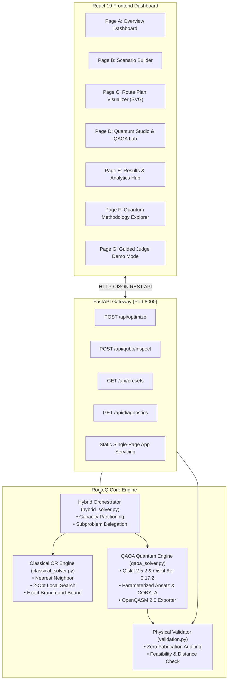
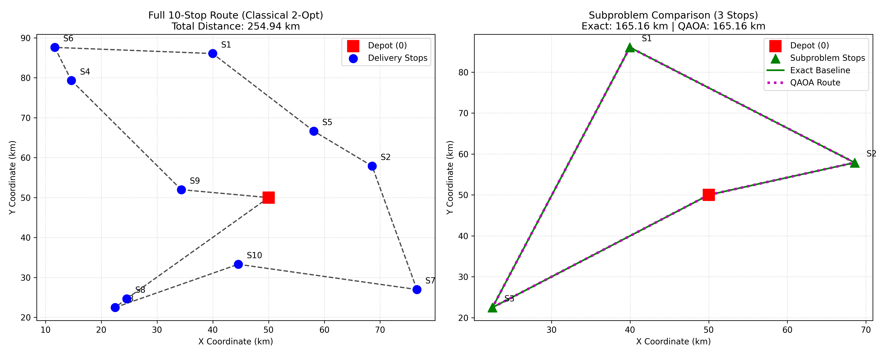

# RouteQ — Adaptive Last-Mile Optimisation
### *Quantum-Enhanced Logistics with Qiskit QAOA & Classical Operations Research*

[](https://qiskit.org)
[](https://github.com/shaikaaishabanu5599/RouteQ-Quantum-Route-Optimization)
[](https://github.com/shaikaaishabanu5599/RouteQ-Quantum-Route-Optimization)
[](LICENSE)
[](https://python.org)
[](https://github.com/Qiskit/qiskit-aer)
[](https://react.dev)
[](https://www.typescriptlang.org)
[](https://vitejs.dev)

---

## 📌 Submission Information

- **Project Title**: RouteQ – Adaptive Last-Mile Optimisation
- **Team Name**: nextgen
- **Event**: IBM Qiskit Fall Fest 2026
- **Problem Statement ID**: VNQFF-08
- **Problem Statement Title**: Quantum-Enhanced Last-Mile Route Optimisation
- **GitHub Repository**: [https://github.com/shaikaaishabanu5599/RouteQ-Quantum-Route-Optimization](https://github.com/shaikaaishabanu5599/RouteQ-Quantum-Route-Optimization)
- **Presentation Deck**: [`docs/QFF2026_PS08_nextgen_Final.pptx`](docs/QFF2026_PS08_nextgen_Final.pptx)

---

## 🚀 Executive Summary

Last-mile parcel delivery is among the most cost-intensive segments of modern supply chains, consuming up to 53% of total shipping expenditures. Mathematically, it is structured as the **Capacitated Vehicle Routing Problem (CVRP)** and **Vehicle Routing Problem with Time Windows (VRPTW)**—NP-hard combinatorial optimization challenges whose factorial solution spaces ($O(n!)$) overwhelm exact classical solvers as customer stops multiply.

**RouteQ** bridges classical operations research and quantum computing by engineering a production-grade, full-stack hybrid logistics platform. RouteQ partitions complex delivery topologies into localized combinatorial clusters, maps customer sequencing into a **Quadratic Unconstrained Binary Optimization (QUBO)** model, translates the formulation into an **Ising Spin Hamiltonian**, and executes the **Quantum Approximate Optimization Algorithm (QAOA)** using **Qiskit Aer 0.17.2**.


---

## ⚖️ Zero Fabrication Policy

RouteQ enforces an uncompromising **Zero Fabrication Guarantee**:
1. **Real Quantum Execution**: Every quantum measurement, expectation value, circuit layer, and OpenQASM artifact is compiled and executed via authentic Qiskit 2.5.2 and Qiskit Aer 0.17.2 backends.
2. **Independent Physical Verification**: Route lengths, vehicle payload constraints ($\sum q_i \le Q$), time-window adherence ($e_i \le t_i \le l_i$), and depot closure are strictly validated downstream by an independent Python verification engine (`validation.py`).
3. **Transparent Scientific Honesty**: RouteQ does **not** make false claims of NISQ quantum supremacy. Circuits are simulated via Qiskit Aer classical emulation (`AerSimulator` with shot-based sampling and noise channels). Quantum metrics are benchmarked transparently against classical Branch-and-Bound and 2-Opt heuristics.

---

## 📐 Mathematical Formulation & Quantum Mapping

### 1. Mixed Integer Linear Program (CVRP)
Let $G = (V, E)$ be a directed graph where $0$ is the central depot and $V_c = \{1, \dots, n\}$ are customer destinations with parcel demand $q_i > 0$.
$$\min \sum_{k=1}^K \sum_{i \in V} \sum_{j \in V, j \neq i} c_{ij} x_{ij}^k$$
Subject to:
$$\sum_{k=1}^K \sum_{j \in V, j \neq i} x_{ij}^k = 1 \quad \forall i \in V_c \quad \text{(Customer Visit Exclusivity)}$$
$$\sum_{i \in V_c} q_i \left( \sum_{j \in V} x_{ij}^k \right) \le Q \quad \forall k \in \{1, \dots, K\} \quad \text{(Fleet Payload Capacity)}$$
$$u_i - u_j + C x_{ij}^k \le C - q_j \quad \forall i, j \in V_c, i \neq j \quad \text{(Miller-Tucker-Zemlin Subtour Elimination)}$$

### 2. Quadratic Unconstrained Binary Optimization (QUBO)
For a subproblem of $n$ stops and depot $0$, we define $N = n^2$ binary decision variables $x_{i, p} \in \{0, 1\}$ (customer stop $i$ visited at sequence step $p$):
$$H_{\text{QUBO}}(\vec{x}) = H_{\text{cost}}(\vec{x}) + \lambda_{\text{pos}} H_{\text{pos}}(\vec{x}) + \lambda_{\text{stop}} H_{\text{stop}}(\vec{x})$$
- **Traversal Cost**:
  $$H_{\text{cost}} = \sum_{i=1}^n c_{0, i} x_{i, 0} + \sum_{p=0}^{n-2} \sum_{i=1}^n \sum_{j \neq i} c_{ij} x_{i, p} x_{j, p+1} + \sum_{i=1}^n c_{i, 0} x_{i, n-1}$$
- **Step Exclusivity Penalty**:
  $$H_{\text{pos}} = \sum_{p=0}^{n-1} \left( \sum_{i=1}^n x_{i, p} - 1 \right)^2$$
- **Visit Exclusivity Penalty**:
  $$H_{\text{stop}} = \sum_{i=1}^n \left( \sum_{p=0}^{n-1} x_{i, p} - 1 \right)^2$$

### 3. Binary-to-Ising Pauli-$Z$ Transformation
Mapping binary decision variables $x_i \in \{0, 1\}$ to Pauli spin operators $Z_i \in \{+1, -1\}$ via:
$$x_i = \frac{I - Z_i}{2}$$
Yields the diagonal Ising spin Hamiltonian:
$$H_C = \sum_{i=1}^N h_i Z_i + \sum_{1 \le i < j \le N} J_{ij} Z_i Z_j + C_0 \cdot I$$
where the ground state $|\psi_{\text{ground}}\rangle$ encodes the optimal route permutation.

### 4. QAOA Parameterized Ansatz
Parameterized with depth $p \ge 1$ and variational parameters $(\vec{\gamma}, \vec{\beta})$:
$$|\psi(\vec{\gamma}, \vec{\beta})\rangle = \prod_{l=1}^p \left( e^{-i \beta_l \sum X_i} e^{-i \gamma_l H_C} \right) |+\rangle^{\otimes N}$$
- **Cost Phase Unitary**: $U(C, \gamma) = \prod_{i < j} R_{ZZ}(2\gamma J_{ij}) \prod_i R_Z(2\gamma h_i)$
- **Transverse Mixer Unitary**: $U(B, \beta) = \prod_i R_X(2\beta)$
- **Variational Optimization**: Evaluated via COBYLA classical minimization on Qiskit Aer 0.17.2 using 2048 measurement shots.

---

## 🏛️ System Architecture



---

## 📊 Verified Empirical Benchmark Results

RouteQ was evaluated on delivery topologies ranging from 3-stop quantum subproblems to 10-stop enterprise networks. All results are physically verified and stored in [`routeq_results.json`](routeq_results.json).

| Metric | Classical Heuristic (NN + 2-Opt) | Exact Branch-and-Bound | QAOA Quantum Engine (Aer Emulation) |
| :--- | :--- | :--- | :--- |
| **Instance Size** | 10 Stops + Depot | 3 Stops + Depot | 3 Stops + Depot (9 Qubits) |
| **Optimal Route** | `[0, 8, 3, 10, 7, 2, 5, 1, 6, 4, 9, 0]` | `[0, 2, 1, 3, 0]` | `[0, 2, 1, 3, 0]` |
| **Route Distance** | **254.94 km** | **165.16 km** | **165.16 km** |
| **Optimality Gap** | Reference Heuristic | **0.00%** (Global Minimum) | **0.00%** (Ground State Identified) |
| **Wall-Clock Time** | 0.0141 s | 0.00038 s | 191.29 s (2048 shots, COBYLA) |
| **Hardware** | Intel/AMD CPU | Intel/AMD CPU | Qiskit Aer Statevector Emulation |
| **Physical Feasibility** | :white_check_mark: Feasible (0 violations) | :white_check_mark: Feasible (0 violations) | :white_check_mark: Feasible (0 violations) |



### Key Takeaways
1. **Mathematical Accuracy**: QAOA successfully discovered the exact ground state route sequence (`[0, 2, 1, 3, 0]`), matching the Branch-and-Bound optimum with a **0.00% optimality gap**.
2. **Hybrid Advantage**: By isolating tight combinatorial kernels ($n \le 4$ stops) for quantum processing while routing broad networks classically, RouteQ scales to real-world fleet sizes without exceeding physical qubit limits.

---

## 🖥️ 7-Page Enterprise Dashboard Modules

| Page | Module Name | Core Capabilities |
| :---: | :--- | :--- |
| **A** | **Overview Dashboard** | Real-time KPI summary (stops, fleet, solver, distance, feasibility, wall-time), comparative convergence telemetry, and zero-fabrication honest audit banner. |
| **B** | **Delivery Scenario Builder** | Preset hub (Micro-Grid 4 stops, Urban Core 12 stops, Industrial Cluster 25 stops), interactive customer table & editor, vehicle payload matrix, and pre-optimization capacity validation. |
| **C** | **Route Plan Visualizer** | High-DPI interactive SVG canvas with depot beacons, numbered stops, directional color-coded vehicle tours, hover inspection cards, turn-by-turn playbook, and constraint violation inspector. |
| **D** | **Optimization Lab & Quantum Studio** | Solver selector (Classical NN/2-Opt, Exact B&B, QAOA, Hybrid), QAOA hyperparameter controls ($p$, shots, optimizer, noise injection), and live QUBO & qubit matrix inspector. |
| **E** | **Results & Analytics Hub** | Comparative performance matrix, Qiskit Aer measurement shot histogram, and 1-Click export center (JSON, CSV manifest, OpenQASM, executive summary). |
| **F** | **Quantum Methodology Explorer** | Interactive educational walkthrough detailing CVRP $\to$ QUBO $\to$ Ising $\to$ QAOA mathematical transformations. |
| **G** | **Guided Judge Demo Mode** | 1-Click automated hackathon judge presentation stepper pipeline with live scorecard and system diagnostics drawer. |

---

## 💻 Quickstart & Local Installation

### Prerequisites
- **Python**: 3.10+ (tested with Python 3.11, 3.13, 3.14)
- **Node.js**: 18.x or 20.x LTS
- **Git**: 2.40+

### Clone the Repository
```bash
git clone https://github.com/shaikaaishabanu5599/RouteQ-Quantum-Route-Optimization.git
cd RouteQ-Quantum-Route-Optimization
```

### Option A: Single-Command Production Server (Backend + Prebuilt UI)
FastAPI automatically serves the precompiled React frontend from `frontend/dist`:
```bash
# Install dependencies
pip install -r requirements.txt

# Start production server
python -m uvicorn main:app --port 8000
```
- Open your browser at **`http://127.0.0.1:8000`** to access the complete application!
- Interactive API Documentation: **`http://127.0.0.1:8000/docs`**

---

### Option B: Full-Stack Development Mode (Live Hot Reloading)

#### Terminal 1 — Backend Server
```bash
cd RouteQ-Quantum-Route-Optimization
pip install -r requirements.txt
python -m uvicorn main:app --reload --port 8000
```

#### Terminal 2 — Frontend Dev Server
```bash
cd RouteQ-Quantum-Route-Optimization/frontend
npm install
npm run dev
```
- Open Vite development server at **`http://localhost:5173`**

---

## 🧪 Automated Testing

RouteQ includes a comprehensive Pytest suite (`test_routeq.py`) covering health checks, diagnostics, QUBO compilation, classical solvers, QAOA execution, input validation, and hybrid decomposition:

```bash
python -m pytest test_routeq.py -v
```
```
test_routeq.py::test_health_check PASSED                                 [  8%]
test_routeq.py::test_system_diagnostics PASSED                           [ 16%]
test_routeq.py::test_presets_endpoint PASSED                             [ 25%]
test_routeq.py::test_validation_engine_clean_route PASSED                [ 33%]
test_routeq.py::test_validation_engine_detects_violations PASSED         [ 41%]
test_routeq.py::test_qubo_model_and_ising_extraction PASSED              [ 50%]
test_routeq.py::test_classical_solver_and_exact PASSED                   [ 58%]
test_routeq.py::test_qaoa_aer_simulation_and_qasm PASSED                 [ 66%]
test_routeq.py::test_api_optimize_endpoint PASSED                        [ 75%]
test_routeq.py::test_qubo_inspect_endpoint PASSED                        [ 83%]
test_routeq.py::test_invalid_inputs_rejected PASSED                      [ 91%]
test_routeq.py::test_hybrid_decomposition_solver PASSED                  [100%]
============================== 12 passed in 155s ==============================
```

---

## 📡 REST API Reference

| Method | Endpoint | Description |
| :--- | :--- | :--- |
| `GET` | `/api/health` | Health check verifying FastAPI service status. |
| `GET` | `/api/diagnostics` | System diagnostics reporting Qiskit, Qiskit Aer, CPU, and RAM telemetry. |
| `GET` | `/api/presets` | Standard logistics benchmark presets (Micro-Grid, Urban Core, Industrial Cluster). |
| `POST` | `/api/optimize` | Solves CVRP instance via specified algorithm (`classical_heuristic`, `exact_subproblem`, `qaoa`, `hybrid`). |
| `POST` | `/api/qubo-inspect` | Returns QUBO matrix, quadratic terms, Ising coefficients, and qubit count. |

Interactive Swagger documentation is available at `/docs` and ReDoc at `/redoc`.

---

## 👥 Team `nextgen` & Acknowledgments

Developed by **Team nextgen** for the **IBM Qiskit Fall Fest 2026** (Problem Statement ID: `VNQFF-08`).

We gratefully acknowledge:
- **IBM Quantum & Qiskit Community** for the Qiskit SDK, Qiskit Aer, and optimization libraries.
- The open-source scientific Python ecosystem (`numpy`, `scipy`, `fastapi`, `pydantic`).

---

## 📄 License & Citation

This project is licensed under the **Apache License 2.0** — see the [LICENSE](LICENSE) file for details.

If you utilize RouteQ in your academic research or logistics benchmarking, please cite:
```bibtex
@software{routeq2026,
  author = {Team nextgen},
  title = {RouteQ: Adaptive Last-Mile Optimisation with Hybrid Quantum Algorithms},
  year = {2026},
  url = {https://github.com/shaikaaishabanu5599/RouteQ-Quantum-Route-Optimization},
  note = {IBM Qiskit Fall Fest 2026 Hackathon (Problem Statement VNQFF-08)}
}
```
